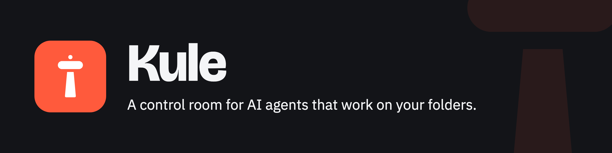

# Kule

Kule is a control room for AI agents that work on your files: code, but
also notes, documents, photos and data. Agents do the work; people watch,
approve and steer. Every command an agent runs is a transaction in a
copy-on-write copy of the folder it works on (the *workspace*), and what
reaches the real folder is decided by the effects the command had, not by
its text.

**Status:** 0.2.0: engine, git, sandbox, policy, proxy, agents over ACP
(Claude Code, Codex, Gemini), the desktop app and its daemon, live approvals,
checkpoints on Lonca with a signed history, secrets, cost and the home
directory caught for review. macOS and Linux. See [CHANGELOG.md](CHANGELOG.md).

**New to Kule?** [The guide](docs/guide.md) walks through the app: a task
from start to finish, every panel and setting, the keyboard, and what is
new. This README is about how each part works underneath.

## Install

From [the releases](https://github.com/kulehq/kule/releases):

- **macOS 13 or later:** `Kule_<version>_universal.dmg`. The `kule`
  command is inside the app: link `/Applications/Kule.app/Contents/MacOS/kule`
  onto your `PATH`.
  - A notarized release also carries `kule.rb`, a Homebrew cask that
    installs the app and links the command.
  - A preview is signed ad hoc, not notarized, so macOS refuses it the first
    time. After checking the download (below), choose **Open Anyway** in
    System Settings → Privacy & Security, or run `xattr -dr
    com.apple.quarantine /Applications/Kule.app` once. Its release notes say
    which kind it is.
- **Linux (x86_64):** the `.deb` (Debian, Ubuntu) or the `.rpm` (Fedora)
  puts `kule-desktop` and `kule` in `/usr/bin`;
  `kule-<version>-linux-x86_64.tar.gz` is the command alone.
- **From source:** `cargo build --release -p kule -p kule-desktop` (Linux
  needs `libwebkit2gtk-4.1-dev`).

Every release file is listed in `SHA256SUMS` and carries a build provenance
attestation. The attestation says the file was built from this repository by
the release workflow. Check them before opening anything:

```sh
shasum -a 256 -c SHA256SUMS --ignore-missing
gh attestation verify Kule_<version>_universal.dmg --repo kulehq/kule
```

The agents are installed and signed in the way they are without Kule:
Claude Code and Codex need Node.js (`npx`), Gemini its CLI. The app's
first screen says which of them can start.

## Any folder, not only repositories

Kule needs no git. A task is a copy of any folder: the agent changes the
copy, you see what changed, and only a commit applies it to the folder,
keeping a checkpoint that undo puts back. When the folder is a git
repository, Kule also reads `.git` as one (see M1, step 1).

- **Notes and documents** (a Markdown or Obsidian vault, reports): let an
  agent restructure them and review the result before anything moves.
- **Photos, downloads, archives**: "sort these into folders" works on the
  copy, so your originals stay where they are until you commit. Moves are
  shown as moves (`» photos/ → 2026/`); in a folder that is not a git
  repository more than 20 deletions wait for you, and undo brings back
  what a commit replaced.
- **Data**: notebooks, CSV files and large datasets; the copy takes no
  space until files change.
- **Something you don't trust yet**: run a script or an installer in a task
  first, and see what it would have changed.

The review says what changed inside each file, by the names a person uses:
functions, methods, fields and types in Rust, C#, TypeScript, JavaScript,
Python and Go; sections in Markdown; keys in JSON and TOML. Every change in
a file is listed under one of them, or under its top level:

```
  ~ notes.md
      + section Plan › Later
  ~ src/task.rs
      ~ method Task::commit
      + method Task::check
```

Tasks on the same folder never see each other's work, so Kule tells where
they meet while both are still going, not when the second commit is
refused: the same method, section or key, or the same file when it cannot
look inside. `kule status` lists it (`task 5e6f7a8b changes them too:
task.rs · method Task::commit`), the app marks the task and lists it under
Review, and, while its window is not in front, the app also tells through
the system's notifications when two tasks start to meet, when an agent
waits for an answer, and when a run is over.

When the second of them commits, a file both changed is merged, three ways
from what both started with: changes to
different methods, sections or keys both go in, two methods added at the
same place are both kept, and the commit says what it merged. Two changes
to the same method, section or key are a conflict by name (`task.rs (both
changed method Task::commit)`), even where their lines do not touch, and so
is a merge whose parts would not stay where either side put them. The same
holds for a file you change by hand in an editor while the agent works:
each task keeps what the folder held at its last sync (one clone on macOS;
elsewhere the files up to 1 MiB, outside `.git`, `node_modules`, `target`
and the like), hidden from the sandbox with the rest of the task.

A changed picture (PNG, JPEG, GIF, WebP) shows what it was and what it is
under Review. Only what its header proves to be such a picture, under
8 MiB and 40 megapixels, reaches the window.

## M0: transactions on a copy-on-write copy

```sh
kule new ~/code/app                  # task 1a2b3c4d · copy at ~/.kule/tasks/1a2b3c4d/copy
kule exec 1a2b3c4d -- rm -rf src     # runs in the copy, then lists what changed
kule status 1a2b3c4d                 # uncommitted changes (--json for machines)
kule rollback 1a2b3c4d               # throw them away: the copy matches the workspace again
kule commit 1a2b3c4d                 # or apply them to the workspace, keeping a checkpoint
kule undo 1a2b3c4d                   # revert the newest commit; repeat to walk further back
```

- The copy is made with reflinks (APFS clones on macOS, `FICLONE` on Linux),
  so it takes no extra space until files change. Filesystems without
  reflinks fall back to a plain copy.
- Effects are found by comparing the copy with the workspace, not by
  watching system calls, so the same logic will run on every platform.
- Commit refuses when the workspace changed underneath (a human edited a file
  the agent also changed, or added files to a directory the agent deleted).
- Commit writes files through a rename, so nobody sees half a file.

## M1, step 1: `.git` as a repository, not as files

`git status` rewrites `.git/index`, every ref update appends to the logs,
and git maintenance adds and removes lock files in the background. Kule
judges `.git` by what it means:

- Objects are only ever added; undo leaves them for `git gc`.
- References are checked by value: a human commit on the branch the agent
  moved is a conflict, while `git pack-refs` or switching branches and back
  is not.
- The index is compared by its entries, not its stat data, so `git status`
  in the workspace blocks neither commit nor undo.
- What the task stages must be what its files hold: an entry staged with
  other content (or taken out of the index while its file stays) waits
  for a person, since the next `git commit` would record what nobody
  reviewed.
- Hooks and `config` changes are reported on their own lines, since they
  make the next `git` command run code.

```
1 file changes: +0 ~1 -0
  ~ crates/lonca-core/src/lib.rs
git: main 8b5ec1d → ad08c52 · fast-forward · 1 commit
git: 6 new object files · index changed
git: config changed (it can make the next git command run code)
git: hook pre-commit changed (it runs on the next matching git command)
```

## M1, step 2: the sandbox

`kule exec` runs commands in the operating system's sandbox (Seatbelt on
macOS, Landlock on Linux). They may write only to the task's copy, its own
`TMPDIR` and `/tmp`; credentials such as `~/.ssh`, `~/.aws`, `~/.npmrc` and
cargo's registry token cannot be read; `--no-network` shuts TCP. Package
managers (cargo, npm, pip, uv, Go, NuGet, Yarn, pnpm) get caches of the
task's own, so nothing a command leaves in a cache reaches a build you run
later; your caches stay read-only. On macOS the cargo and npm caches start
as copy-on-write clones of yours. If the sandbox cannot be
set up, the command does not run. `--allow-write`, `--hide`, `--reveal` and
`--no-sandbox` adjust it. On macOS, what the sandbox refused is printed after
the command and kept in the task's `sandbox.jsonl`:

```
sandbox: refused file-read-data /Users/me/.config/gh/config.yml (gh)
sandbox: refused file-write-create /Users/me/.zshrc (sh)
```

## M1, step 3: policy

Every change is judged by a Cedar policy before it reaches the workspace:
it passes on its own, waits for approval, or is denied.

```
policy: waits for approval
  Cargo.toml · waits for approval (manifests-and-lockfiles)
```

`kule commit` applies what passes, `kule commit --approve` also what
waits, and nothing that is denied (a new git hook, for example). `kule
policy` prints the rules that hold. The built-in ones (*balanced*): source
edits and fast-forward branch moves pass; manifests, lockfiles, CI and
editor configuration, what runs code on its own (build scripts an editor
runs, package manager and toolchain settings, hook managers) or steers an
agent (its settings, instructions and MCP servers), a repository inside the
folder, links, git config, history rewrites and mass deletes wait — in any
folder and however the name is cased (more than 200, or more than 20
outside a git repository; a file renamed in the copy is a move, not a
deletion); git hooks are denied, a nested repository's too. `kule policy
careful` (or *Policy* in the app's Settings) makes every change to a file
or to git wait; `kule policy balanced` goes back. Save your own as
`~/.kule/policy.cedar` to replace them; Kule never overwrites it. A
repository can add `forbid` rules in `.kule/policy.cedar`; they are read
from the real workspace, never from the copy an agent edits.

What you approve can be remembered, so it is asked once: `kule commit
--approve --remember` (or *Don't ask again in this folder* in the app) lets
later changes to those manifests, CI or project files through on that
folder, and *Approve and remember* on a question lets that host and port
through. `kule rules allow api.example.com:443` shows what an allowance
would have let through in your past tasks before `--yes` keeps it; `kule
rules` lists them and `kule rules forget` takes one back. A connection
becomes a Cedar `permit`; a file, a narrow exception to the rule that
asked about it. What is denied, what asks for reasons other than a file's
name (a mass delete, a history rewrite) and anything under `.kule/` are
never remembered.

## M1, step 4: the network goes through a proxy

Commands can connect only to the task's proxy; the proxy variables point at
it. Each connection is judged by the same policy (`net.connect`): package
registries and model APIs pass, anything else is refused until the approval
inbox exists. Every connection lands in the task's `network.jsonl`.

```
net: registry.npmjs.org:443 · tunneled (package-registries)
net: example.com:443 ×2 · refused, waits for approval (no-rule-lets-it-pass)
```

`--no-network` shuts TCP; `--open-network` bypasses proxy and policy.

## M1 in practice

A headless Claude Code run inside the sandbox fixed a failing test in a
small Rust repository and committed the fix; the policy let the result pass
on its own and `kule commit` applied it:

```sh
kule exec $TASK --reveal ~/Library/Keychains \
  --allow-write ~/.claude --allow-write ~/.claude.json \
  -- claude -p "Fix the failing test, run cargo test, commit the fix." \
     --allowedTools "Bash,Read,Edit,Write" --permission-prompts none
kule status $TASK   # policy: passes on its own
kule commit $TASK
```

## M2: agents over ACP, and the desktop app

`kule run $TASK --agent claude-code "prompt"` starts the agent over the
Agent Client Protocol inside the sandbox. Its profile opens only the agent's
own state and login; other agents' logins and transcripts stay hidden. Every
tool call becomes a step (`kule steps $TASK`).

Claude Code, Codex and Gemini come built in. Any other agent that speaks
ACP is added as a profile in `~/.kule/agents.toml`, in the format `kule
agents show claude-code` prints:

```toml
[[agent]]
name = "opencode"
command = ["npx", "-y", "opencode-ai@1.2.3", "acp"]
state = [".local/share/opencode"]          # what it may write, under ~
login = [".local/share/opencode/auth.json"] # hidden from every other agent
keys = { OPENROUTER_API_KEY = ["openrouter.ai"] } # your API key, never seen by it
hosts = ["openrouter.ai"]                   # HTTPS hosts it reaches, while it runs
```

A profile opens holes in the sandbox, so yours runs only once you approve
it (`kule agents approve opencode`, after `kule agents show opencode`), and
again after any change to it. It may never open the credentials Kule hides,
another agent's state, Kule's home or a whole directory like `~/Documents`,
and a package it fetches must name one exact version. Profiles live in
Kule's home, which no sandbox can see, and never come from a workspace.

An agent `npx` fetches (Claude Code's and Codex's ACP adapters) is
installed once per version, outside the sandbox and without running the
package's install scripts, under `~/Library/Application Support/Kule/packages`
(`~/.local/share/kule/packages` on Linux), which no sandbox can write. It
starts from there with `node`, so a new task does not fetch it again into
its own npm cache.

Under `keys`, the agent's variable holds a placeholder of the run and the
task's proxy puts your key into requests to the hosts named, as it does
for a kept secret (see below); the built-in agents take
`ANTHROPIC_API_KEY`, `OPENAI_API_KEY` and `GEMINI_API_KEY` this way. A
variable under `pass_env` the agent sees as it is.

To find what a new agent needs, try it: `kule agents add qwen-code` takes
a draft from the [ACP registry](https://agentclientprotocol.com/registry)
(`kule agents registry` lists it), and `kule agents try qwen-code` runs it
once in an empty folder, opened no wider than its draft, then lists what
the sandbox refused it: the directories it wanted to write to and the hosts
it wanted to reach. `--apply` adds those to the profile, which then waits
for your approval like any change. The app's **Agents** settings do the same
with checkboxes, so a telemetry host can stay out. Linux does not report
refused files, so there only hosts are suggested.

An agent's own directory is outside the sandbox, and what the agent writes
there in Kule reaches it the next time you start it without Kule. So what
makes an agent run something or follow instructions when it starts is
read-only in the sandbox: settings, hooks, plugins, extensions, skills,
commands, rules, trusted folders and its `CLAUDE.md`/`AGENTS.md`/
`GEMINI.md`. Kule's own profiles cover these; for yours, a trial suggests
them and `kule agents show` warns about any left writable. Or give an agent
a home of its own in Kule: `own_home = "CODEX_HOME"` (or `CLAUDE_CONFIG_DIR`,
or `HOME`) points that variable at a folder of the agent's own, so nothing
it writes in Kule reaches it outside; you sign it in there once.

`crates/kule-desktop` is a Tauri app around the same engine:

- **Tasks**: pick a folder to make a task; each shows its changes and the
  policy's verdict. Tasks waiting for approval collect under *Needs you*.
  A task's ⋮ menu (or a right click) names it, shown after its folder's
  name (`Downloads – march invoices`), marks it with a colour, opens a
  terminal in its copy or deletes it. Drag a task, or press Alt+↑/↓, to
  move it in the list; `kule list` keeps that order, and `kule name` and
  `kule color` do the rest from a terminal.
- **Groups**: the + next to *Tasks* makes a group, with a name and a
  colour of its own (change it from the group's ⋮ menu); its tasks show
  that colour unless they have their own. Put a task in one from its ⋮
  menu (*Group…*) or drag it onto the group; drag it onto *Not in a group*
  to take it out. When the move would change the verdict on any of the
  task's pending changes (a change waiting for you that would pass on its
  own, say), Kule asks first and lists them. A group's tasks are judged by
  the group's policy: the one for
  every task (the default), Kule's balanced or careful one whatever holds
  for the rest, or one you write for the group in *Settings → Policy*,
  checked before it is kept. A repository's refusals and what you told
  Kule not to ask about again still hold. `kule group` does the same from
  a terminal (`new`, `put`, `policy`, `rename`, `color`, `delete`).
- **Settings**: agents, the policy, remembered rules, secrets, the
  budgets (the daily one and each task's), the limits on what a run takes,
  appearance, shortcuts, extensions and your profile, one section each.
- **First run**: with no task yet, the window shows which agents can start
  (and what to install for those that cannot), lets you choose the
  balanced or careful policy, then asks for a folder. Opened from the
  Finder or a launcher, the app takes `PATH` from your login shell, so
  agents find `npx` and the rest as they do in a terminal.
- **Keyboard**: everything the window does is a command with a shortcut
  (Mod is ⌘ on macOS, Ctrl on Windows and Linux): Mod+K finds any command
  by name, Mod+N makes a task, Ctrl+Tab moves between tasks, Mod+1/2/3
  show the agent chat, Review and Timeline, Enter runs the prompt
  (Shift+Enter for a new line, Mod+Enter too),
  Mod+Shift+Enter commits, Mod+Shift+Y and Mod+Shift+N answer a waiting
  connection. Settings → Shortcuts lists them all and lets you set your
  own; they are kept in Kule's home (`shortcuts.json`). Combos the system
  or text editing owns (⌘Q, Alt+F4, Ctrl+Alt+arrows on Linux, copy and
  paste) are never taken, and in a text field only the shortcuts meant
  for it fire.
- **Appearance**: Kule's themes (System, which follows the computer, Light,
  Dark, Coral, Nord, Solarized Light and two high-contrast ones) and your
  own, made from any of them in Settings → Appearance with a live preview
  and a warning for colour pairs too faint to read. A theme goes to and
  comes from a `.kule-theme.json` file that holds colours for the
  window's named parts and nothing else (`#rrggbb`, checked on the way
  in). The theme in use and your own are kept in `themes.json`, with
  **Motion**: the small movements where something changes (a menu opening,
  a question arriving, a row moving), on, off, or as the computer's
  "reduce motion" says.
- **Layout**: the window is four regions, left, main, right and bottom,
  each holding panels as tabs. By default the agent's chat and the
  terminals share the bottom, side by side (`Agent | zsh 1 | zsh 2 | +`),
  and the main area shows Review, Timeline and Preview. Any region hides with the
  button at the end of its tab bar or from the switches at the right of the
  title bar (on macOS the window's own, as in VS Code); the bottom
  panel can fill the window, and the main area and the bottom panel are
  never hidden together. Mod+Shift+J shows or hides the chat, Ctrl+\` the
  terminal. The panels are Tasks, Agent, Review, Timeline, Files (the
  task's copy as a tree, changed files marked), Preview (see below)
  and Terminal (your shells in the copy, as many as you open, each a tab;
  outside the sandbox like a task's *Open terminal*; Ctrl+\` shows it,
  Ctrl+Shift+\` opens another, ⌘F or Ctrl+Shift+F finds text, ⌘/Ctrl+click
  opens an http or https link; outside macOS only Ctrl+Shift shortcuts and
  function keys leave it, so Ctrl+L and the rest stay the shell's). The
  agent's panel reads like the terminal beside it: the conversation fills
  it and the prompt is a command line at the bottom that grows as you
  write. Drag a panel's tab to another region, or use its menu or the
  keyboard; open and close the regions from the bar on the left (Mod+B,
  Mod+J, Mod+Alt+B) and resize them by their edges. The layout is kept in
  `layout.json`; *Reset the layout* goes back to Kule's own. Files and
  the Preview never follow a link or leave the copy.
- **Preview**: a file picked in Files opens large in the main area
  (Mod+4), as it is now in the task's copy: text and code with line
  numbers (packed JSON or XML formatted on request, up to 1 MB), Markdown
  laid out, PNG, JPEG, GIF and WebP pictures, CSV and Excel files as
  sheets from A1 with each cell's value or formula, and Word documents as
  headings, paragraphs, numbered lists and tables. Excel and Word files
  are read in memory, never unpacked, each part inflated through a cap.
  To ask the agent about a place, pick text, drag over cells or over part
  of a picture: an **Ask** button shows beside it (Mod+Shift+A, or, with
  nothing picked, the whole file). Its box asks the agent now or adds the
  place to the prompt as a chip; a prompt names up to 20 places. The agent
  gets them as a numbered list after the prompt, each named so it can find
  it: lines, a section and its headings, cells and their values, a region
  in the picture's pixels, a numbered paragraph. An agent that takes
  pictures also gets each region as a picture (three to a prompt).
- **Menu bar**: File, Edit, View, Task and Help (with Kule and Window on
  macOS), at the top of the screen on macOS and of the window on Windows
  and Linux. Every item runs the same command as its shortcut and shows
  the one you set, except shortcuts text editing owns too (⌘⌫, ⌥⇧↑), which
  stay in the window so they keep working in a text field.
- **Profile**: your choices in one `.kule-profile.json` file, all of them
  or the parts you tick: the theme in use, your own themes and the motion, your
  shortcuts, Kule's balanced or careful policy, the daily budget, the
  limits and the agent profiles you added. On import Kule shows what the file holds
  before anything changes, and you pick the parts to apply; themes join
  yours, the rest take the profile's, and its agents wait for your
  approval before they run. Secrets, remembered approvals and a policy
  you wrote yourself never go into a profile.
- **Live**: the agent's answer, tool calls and what each changed, as they
  come.
- **Review**: the effect set and the ruling, with *Commit*, *Approve and
  commit* or *Roll back*.
- **Timeline**: commits (with undo), uncommitted steps, network connections
  and sandbox refusals.

```sh
cargo run -p kule-desktop   # Linux needs libwebkit2gtk-4.1-dev
```

The app is a window onto the Kule daemon (`kule daemon`), which it starts
when none is running. The daemon owns the tasks, the agents' runs and the
questions they wait on, so closing the window stops nothing, and reopening
it shows what happened meanwhile. It listens on `<home>/kuled.sock`, which
only its owner can open (checked by peer credentials too), runs once per
home, and exits after ten idle minutes.

What a commit replaced is kept in the task's own Lonca store (git objects
under `checkpoints/store.git`, with modes and times beside them), and every
commit and undo is an entry in a signed, hash-chained history (`kule history
TASK`). The signing key lives in Kule's home and is hidden from every
sandbox.

Paths the workspace's `.gitignore` excludes (build output, caches, `.env`)
stay in the copy: a commit leaves them behind unless asked
(`kule commit --include-ignored`, or *Also commit these* in the app). The
rules come from the workspace, never from the copy.

In the app, a connection the policy puts to a person waits for an answer:
it shows under *Needs you* and on the task's Live tab with Approve and
Deny. Unanswered, it is refused when the task's wait runs out (15 minutes
unless set from 1 minute to 8 hours; never off) and the agent is told to
go on without it. The CLI has nobody to ask and refuses such connections
at once.

What each run used, as its agent reported it, is kept with the task
(`usage.jsonl`, outside the copy): tokens, the context window, and the
cost when the agent says. `kule status` and the app's task header add it
up. `kule budget TASK 5` (USD unless a currency follows; `off` takes it
away), or *Settings → Budget* in the app (also a task's ⋮ menu), caps
what the task's runs may cost
together: no run starts once it is spent, and a run whose agent reports
its cost as it works is cancelled when it gets there. Claude Code reports
the cost as each turn ends, so its turn can go over and the next run is
the one refused. Codex signed in with ChatGPT reports tokens but no cost,
Gemini reports neither, and a budget does not hold what is not reported.
`kule daily-budget 20` (or *Budget* in the app's Settings) caps what
every task may cost together in any 24 hours, the same
way; a run is held to the tighter of the two. The app tells you when a
task has spent 80% of its budget, and when it has spent it all.

*Settings → Limits* (also a task's ⋮ menu) sets what a run may take of
this computer, for every task and, field by field, for each one:

- **Processor**, in cores: over it the run is slowed down, not stopped.
  Kule pauses and resumes its processes in turn (`SIGSTOP`/`SIGCONT`,
  a tenth of a second at a time), which needs no privileges on either
  system.
- **Memory**: what the run's processes hold together (their footprint on
  macOS, their proportional share on Linux). Over it they are killed at
  once.
- **Disk**: what the task's copy, temporary files and home changes may
  grow by since the task was made. Kule measures it as often as a walk
  through them allows (at most every second) and stops the run over it;
  no single file can be written past it.
- **GPU**, on or off: off, Metal (and OpenCL through it) gets no device on
  macOS, and `/dev/dri` and NVIDIA's devices stay read-only on Linux. No
  system lets a share of a GPU be set.
- **Time**: one run's, all of a task's runs' together (none starts once it
  is used up), and how long the agent may do nothing (no message, tool
  call, output, processor use or new process) before the run stops. A
  question waiting on you does not count as doing nothing.

A run stopped by a limit fails with why, in Live. **Stop** (⌘⇧K) stops
the run at work: its turn is cancelled, and the agent is killed if it does
not end it within ten seconds. While a run goes on, Live shows what it
takes against its limits. `kule run` is held to the same limits.

## Writes in your home, caught for review

An agent that runs `git config --global`, adds a line to `~/.zshrc` or
writes a tool's settings under `~/.config` is not refused any more, and
does not reach your home either. Its `HOME` is the task's home layer
(`<task>/home`): the small files at the top of your home and `~/.config`
are clones there (APFS clones them in one go; elsewhere `.config` is
copied while it stays under 64 MiB), and what is new at the top lands
there too. Every other entry is a link to your own, so toolchains, caches
and settings are found where they always are, and a write through a link
meets the sandbox as before. The agent's own state is linked and never
offered; hidden paths (`~/.ssh`, `~/.aws`, …) are not in the layer at all;
a directory you cannot read whole is linked. Shell histories and
completion dumps are not offered either.

`kule status` and the app's Review tab list what waits (`in your home,
caught for review`). `kule home TASK diff ~/.zshrc` (or *Show*) shows
what a change would do to your file, line by line. A file that shells or
tools read and run as they start (`.zshrc`, `.profile`, `.gitconfig`,
`~/.config/fish`, `~/.config/autostart`, systemd user units, …) is marked
*runs at every start*, and the app opens its diff from the first look.
`kule home TASK apply ~/.zshrc` (or *Apply*) takes one change to your
home after checking your file is still as it was when the layer was
made, and keeps what it replaced in the task's `home-kept/`;
`kule home TASK undo` takes the last apply back, if you have not changed
those paths since, and the changes wait for review again.
`kule home TASK discard --all` throws them away. A home
change is never part of a commit. While changes wait, the layer stays as
it is from run to run; once none do, the next run starts from your home as
it is then. `kule exec` uses the layer too; a trial of an agent profile
does not, since it learns the agent's directories from what is refused.

## Secrets the agent never sees

`kule secrets add STRIPE_KEY --host api.stripe.com` (the value is typed
without echo, or piped in; never an argument) keeps a secret in Kule's
home, hidden from every sandbox, its value sealed with a key your system's
keychain (macOS) or Secret Service (Linux) keeps; a computer without one,
or a home other than `~/.kule`, keeps the key in a file beside, and
Settings → Secrets says so. A task's
commands find a placeholder in `$STRIPE_KEY`. The task's proxy looks
inside TLS for the secret's hosts and no other: it makes a certificate
authority of its own for each run, valid only for those hosts by its name
constraints, with a key that never leaves its memory, and points
`SSL_CERT_FILE`, `NODE_EXTRA_CA_CERTS`, `REQUESTS_CA_BUNDLE` and the like
at it. On the way to `api.stripe.com` the placeholder in a credential
header (`Authorization`, `Basic` included; `x-api-key`, `x-goog-api-key`
and the like) becomes the value; in the URL, any other header or the body
it stays a placeholder, so the value never reaches what could repeat it
back, and sent anywhere else it is a string that opens nothing. A request
to that host carrying credentials Kule does not hold for it is refused
(403). Requests on a connection follow one
another (keep-alive); one whose framing two readers could take
differently is refused. The connection log names
the secrets that went out (`net: api.stripe.com:443 · tunneled · with
STRIPE_KEY`). A response that repeats the value has it blanked out with
`*` (the proxy asks for it uncompressed), as far as it can read it.

Values in the copy's `.env` files (`.env`, `.env.local`, `*.env`,
`.envrc`; not `.env.example`) that look like secrets, by their name or
their shape, are replaced with placeholders when the task is made, after
each commit, rollback and undo, and before every run. The folder keeps the
real ones: a commit puts them back into a settings file the agent changed,
and merges with the real values. A masked value that is also a kept secret
gets that secret's placeholder, so it reaches the secret's hosts; any other
stays where it is. The app's Settings have a *Secrets* section; `kule
secrets list` and `remove` do the rest.

What it does not do yet: HTTP/2 (clients fall back to HTTP/1.1), a
placeholder split by a chunk edge or in a body larger than 1 MiB,
WebSocket upgrades, and Go programs on macOS, which trust the system
keychain alone (Kule never adds its authority there).

## Extensions

An extension adds commands, panels, themes, settings, notes on a review,
agent profiles or MCP servers. It is JavaScript in a folder, shared as a
`.kulext` file. Kule trusts it no more than an agent:
- it asks for permissions from a closed list, and runs only once the person
  approves exactly the version they saw;
- a change waits for approval again;
- its code runs in sandboxed frames that reach nothing but Kule.

No permission reaches secrets, answers to questions, commit, rollback, undo
or policies. Agents and MCP servers it brings each wait for their own
approval.

```sh
kule ext new me.hello && kule ext dev hello && kule ext approve me.hello
```

[docs/extensions.md](docs/extensions.md) covers the manifest, the
permissions, the SDK and the package format;
[examples/extensions](examples/extensions) has three to read.

## Not yet

- Linux: Landlock reports refusals only to the audit log, so they are not
  listed; the command still gets EPERM. Network rules need Linux 6.7.
  Commands get a network namespace of their own, with nothing but the
  proxy in reach; that takes unprivileged user namespaces, which Ubuntu
  24.04 refuses by default (`sysctl
  kernel.apparmor_restrict_unprivileged_userns=0`). Without them Kule runs
  no agent until you accept weaker isolation (Settings → Policy, or `kule
  isolation --accept-weaker on`), and says what is missing while you do.
  Unix sockets outside the task's folders are out of reach through
  Landlock's rule for them (ABI 9), or covered for the command on older
  kernels. An agent's settings inside its
  state directory are mounted read-only for the agent alone, so changes the
  person makes meanwhile stay. Without user namespaces, and for settings
  that are links or do not exist yet, they are put back after the run
  instead; whatever a put-back replaces is moved to `~/.kule/kept/replaced`,
  never lost. A read-only directory too large to put back (plugins can
  run to hundreds of megabytes) is hidden from the agent instead; Landlock
  then opens the directory around it by what is in it, so the agent can
  write in its subdirectories and files but not add new files beside them.
- Package registries are read-only to commands (a publish is refused) for
  npm, yarn, pnpm and bun, cargo, pip, uv and poetry, and gem, whose
  tools trust the task's authority. Go's, NuGet's and Maven's tools on
  macOS trust the system's roots alone, so their registries pass through
  unseen, writes included.
- Gemini needs an API key from AI Studio (Google no longer serves the
  Code Assist sign-in to clients like this), saved outside the keychain,
  which the sandbox keeps read-only: `GEMINI_FORCE_FILE_STORAGE=true gemini`,
  then `/auth`. Codex works with a ChatGPT sign-in (`codex login`).
- Windows (v1).

## Security

Kule is built on Zero Trust and follows OWASP: the agent and everything it
produces are untrusted, and every boundary is denied by default. Report a
vulnerability privately as [SECURITY.md](SECURITY.md) says, never in a
public issue.

## License

Apache-2.0
